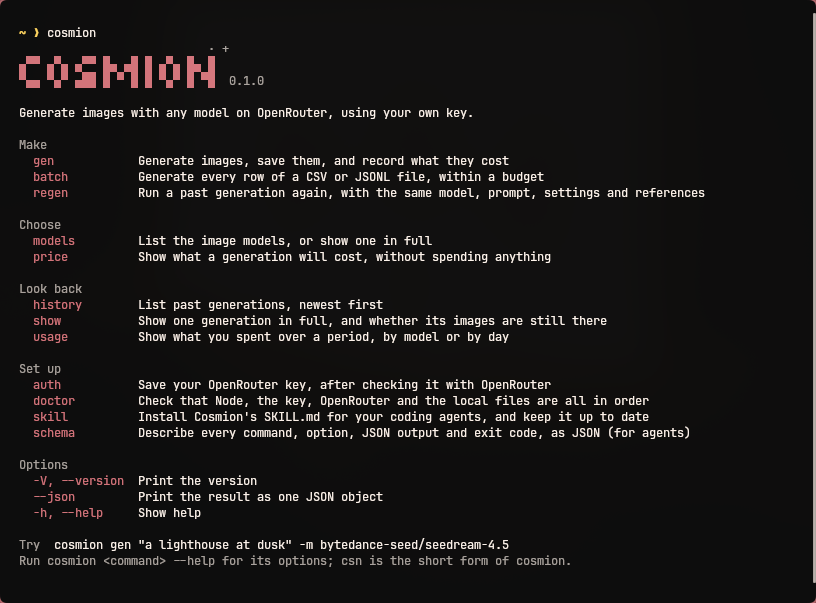

# Cosmion

Cosmion lets your coding agent generate images, using any image model on OpenRouter and
your own API key. You can run it yourself from a terminal too. You can check a price before
you spend, and Cosmion records what every image cost.

[OpenRouter](https://openrouter.ai) is a service that gives you one API key for AI models
from many providers.



```sh
npm install -g cosmion
```

You need Node 22.12 or newer, on macOS, Linux or Windows.

## Get started

1. Create a key at [openrouter.ai/settings/keys](https://openrouter.ai/settings/keys) and
   save it:

   ```sh
   cosmion auth
   ```

   Cosmion asks for the key without displaying it, checks it with OpenRouter and saves it
   so that only you can read it.

   If you'd rather not save it, set the `OPENROUTER_API_KEY` environment variable instead
   (see [Environment variables](#environment-variables)):

   ```sh
   export OPENROUTER_API_KEY=<your key>
   ```

   Give the key a spending limit on OpenRouter. OpenRouter enforces the limit, so it
   applies to anything using the key, including an agent.

2. List the image models, then check what one costs. These examples use Seedream 4.5, but
   any model from the list works:

   ```sh
   cosmion models
   cosmion price -m bytedance-seed/seedream-4.5 --resolution 2K
   ```

   Many models have no fixed price, so `cosmion price` says the price is unknown until the
   first image with those settings. It also shows the model's listed rate if it has one,
   but that rate isn't the cost of an image. Once you've generated an image, `cosmion price`
   can estimate from that image, as long as the model and settings match (the prompt and
   seed can differ).

3. Generate an image:

   ```sh
   cosmion gen "a red bicycle outside a bakery, watercolor" -m bytedance-seed/seedream-4.5 \
     --resolution 2K --out bicycle.png
   ```

   `cosmion gen` starts straight away, without showing the price or asking you to confirm,
   so run `cosmion price` first if you want to know. When it finishes, it shows what the
   image cost, saves the image and adds both to your history. To see your history and
   spending:

   ```sh
   cosmion history
   cosmion usage --by day
   ```

To stop passing `-m` every time, set the `COSMION_MODEL` environment variable.

## With an agent

[`SKILL.md`](SKILL.md) is the file that tells an agent how to use Cosmion. To install it:

```sh
cosmion skill install
```

Cosmion asks whether to install for all projects or just this one, then which agents to
install for: Claude Code, Codex, OpenCode, Antigravity, Cursor, Grok Build or Copilot. An
agent with its own skills folder gets its own copy. The **Shared folder** choice in that
list installs to `.agents/skills`, which Codex and most other agents read.

If your agent isn't on the list, pass its skills folder instead:

```sh
cosmion skill install --dir <path>
```

Then ask your agent something like this:

> Make a 16:9 hero image of a bakery at sunrise for the landing page and save it as
> `public/hero.png`. Tell me what it will cost before you generate it.

The skill tells agents to check the price when cost matters, but an agent won't always stop
to tell you first. If you want to see the price before it spends anything, ask for that, as
above.

The agent runs something like this, then reads the saved path and `cost_usd` from the
result:

```sh
cosmion price -m bytedance-seed/seedream-4.5 --aspect 16:9 --json
cosmion gen "a bakery at sunrise" -m bytedance-seed/seedream-4.5 --aspect 16:9 \
  --out public/hero.png --json
```

Every command takes `--json` and prints one JSON object on stdout. Exit codes are stable,
and Cosmion never prompts when there's no terminal. For many images, `cosmion batch` takes
a `--budget`, and a row only starts if its price fits in what's left of the budget.

### Keeping the skill up to date

After you upgrade Cosmion, run `cosmion skill update`. It only updates copies made by
`cosmion skill install`, and only in these places:

- **All projects:** updated from any folder.
- **This project:** updated only when you run the command inside that project.
- **`--dir`:** updated only when you pass the folder again:
  `cosmion skill update --dir <path>`.

`cosmion doctor` warns you about out-of-date copies in the first two places, if you run it
inside the project. It doesn't check `--dir` folders.

### Copying the skill by hand

Take `$(npm root -g)/cosmion/SKILL.md` and put it in the agent's skills folder as
`cosmion/SKILL.md`. Cosmion doesn't track a copy made this way, so `skill update` and
`doctor` skip it and you need to replace it yourself after upgrading. To have Cosmion take
it over, run `cosmion skill install` with `--force`.

## Commands

| Command | Does |
|---------|------|
| `cosmion gen <prompt>` | Generate images and save them |
| `cosmion price` | Show what a generation will cost, without spending anything |
| `cosmion models [id]` | List the image models, or show one with its options and prices |
| `cosmion models rank` | List the models that support the options you pass, cheapest first |
| `cosmion batch <file>` | Generate every row of a CSV or JSONL file, within a budget |
| `cosmion regen <id>` | Run a past generation again, with the same settings and seed |
| `cosmion history` | List past generations, newest first |
| `cosmion show <id>` | Show one generation in full |
| `cosmion usage` | Show what you spent, by model or by day |
| `cosmion auth` | Save your key (`auth status`, `auth logout`) |
| `cosmion skill install` | Install `SKILL.md` for your coding agents (`skill update`, `skill uninstall`) |
| `cosmion doctor` | Check that everything is set up |
| `cosmion schema` | Print the whole interface as JSON, for agents |

`cosmion <command> --help` shows each command's options. `csn` is a shorter name for
`cosmion`, so `csn gen …` does the same as `cosmion gen …`.

In a terminal, output has color and tables fit the window. Piped output stays plain.

## Environment variables

| Variable | Does |
|----------|------|
| `OPENROUTER_API_KEY` | Your OpenRouter key; used instead of the saved one while set |
| `COSMION_MODEL` | The model to use when you don't pass `-m` |
| `COSMION_HOME` | Keep all of Cosmion's files in this folder (see [Where files go](#where-files-go)) |
| `COSMION_DEBUG` | Set to `1` to add the stack trace to an unexpected error |
| `NO_COLOR` | Set to `1` to turn off colors and styling |

`export` sets a variable for the terminal you're in:

```sh
export COSMION_MODEL=bytedance-seed/seedream-4.5
```

To keep it for every new terminal, add that line to your shell's profile, such as
`~/.zshrc` or `~/.bashrc`. In Windows PowerShell, use
`$env:COSMION_MODEL = "bytedance-seed/seedream-4.5"` for the current window, or `setx
COSMION_MODEL "bytedance-seed/seedream-4.5"` for new ones.

An agent only sees variables from the environment it was started in. If yours can't see
your key, save it with `cosmion auth` instead.

## Privacy

Your images and history stay on your machine. Prompts and reference images go to
OpenRouter and the model's provider.

## Where files go

Images go where you tell them with `--out`, or in the current folder if you don't.

Your key, history and the model catalog cache live in your system's usual folders for app
config, data and cache. To keep them all in one folder, set the `COSMION_HOME` environment
variable and leave it set:

```sh
export COSMION_HOME=~/cosmion-files
```

Cosmion only uses that folder while the variable is set. It doesn't move your existing
files, so you'll start with an empty history and need to run `cosmion auth` again, unless
you move them yourself.

## Troubleshooting

`cosmion doctor` checks Node, your key, OpenRouter, the folders and the history, and tells
you how to fix anything that's wrong.

If Cosmion reports an unexpected error, put `COSMION_DEBUG=1` in front of the command that
failed. That sets the variable for that one command and adds a stack trace you can include
in a bug report:

```sh
COSMION_DEBUG=1 cosmion gen "…"
```

## Why I built this

Some coding agents can generate images, but many can't. I wanted mine to be able to, so I
built a tool for it. Any agent that can run a command can use Cosmion.

My first attempt was
[`pp-openrouter-image`](https://www.skills.sh/mvanhorn/printing-press-library/pp-openrouter-image),
now in the CLI Printing Press library. I made it with Printing Press and an AI agent called
Hermes, texting instructions over Telegram until it was ready to publish. Printing Press
has its own way of building things, though, and it's code lives in their library. I wanted to build something that felt more like my own product, and something I could share from my own repo.

I built Cosmion with AI coding agents too, but I was more involved this time. I chose the
tech stack and directed the work, especially how it feels to use and how it looks in the
terminal. I wanted it to feel like a real product, even though it's free. I maintain it in
my own repo.

I hope it solves the same problem for you.

## License

MIT
